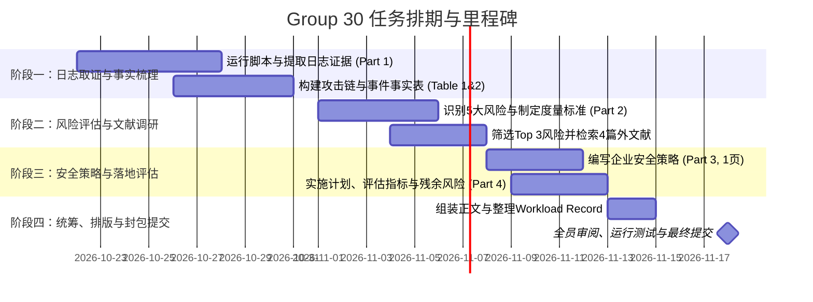

# 📅 Enterprise Cyber Security (ECS) - Group 30 Project Roadmap & Deadlines

> **项目名称**：Evidence-based Policy Group Assessment (From log evidence to security policy)  
> **小组编号**：Group 30 (`Solstice Continental` 案例)  
> **最终官方截止时间**：**2026年11月18日（周三）16:30 (UTC)**  
> **考核占比**：课程总成绩 20%  
> **报告限制**：正文严格不得超过 6 页（12pt 字体、1 英寸页边距），包含 1 页必填的 Workload Record

---

## 📌 一、 官方关键时间节点（Official Deadlines）

| 截止日期 | 时间 | 事项 | 责任人 / 提交方式 | 状态 |
| :--- | :--- | :--- | :--- | :--- |
| **2026-10-16** | 23:59 | Group AI Declaration（联合 AI 使用声明） | 全组协商后在 Moodle 勾选提交 | ✅ 已截止 |
| **2026-10-30** | 23:59 | **Group Wellbeing Survey（小组健康与合作问卷）** | 全体组员各自在 Moodle 完成 | ⏳ **进行中**（下周五前） |
| **2026-11-18** | **16:30** | **Final Assessment Submission（最终大作业 Zip 提交）** | 指定一名组员在 Moodle 代表全组提交 | 🚨 **终极截止日** |
| **2026-11-18** | 16:30 稍后 | Personal Assessment of Contribution (个人贡献私密互评) | 每位组员各自在 Moodle 单独提交（勿放入 Zip） | 🚨 **个人评分项** |

---

## 🚀 二、 小组内部冲刺排期表（Internal Milestone Timeline）

为了预留充裕的修改、查重与排版时间，建议全组在 **11月15日（提前3天）** 冻结终稿并完成打包。

### 详细时间规划表

| 阶段 / 周期 | 内部截止日期 | 核心产出目标 (Deliverables) | 涉及分工建议 | 评审/检查要点 |
| :--- | :--- | :--- | :--- | :--- |
| **第一阶段** 日志取证与攻击链梳理 *(占比 25%)* | **10月28日 (周三)** | 1. 运行 `analysis.py` 跑通 `group30` 的两个日志文件 2. 产出 `source_summary.csv` 与 `evidence_*.txt` 3. 确定攻击者 IP、失陷账号与事件时间线 | 组员 A & B（负责技术与代码跑数） | 确保数字 100% 来自 Group 30 自身日志，切勿抄袭其他组数据 |
| **第二阶段** 撰写 Part 1 & 构建风险矩阵 *(占比 30%)* | **11月04日 (周三)** | 1. 完成 **Part 1**（约1.5页，含 Table 1 事实表、Table 2 攻击链） 2. 识别至少 5 个具体风险（**必须同时包含恶意攻击 Malicious 与非恶意失误 Non-malicious**） 3. 制定 5 级似然度与影响度标度（设定单位、上限为最坏可信场景 Worst credible case） 4. 检索至少 4 篇外部权威文献（必含 1 篇同行评审期刊） | 组员 C & D（负责风险量化与文献调研） | 矩阵排名前 3 的核心风险必须逻辑严密，并说明后两项未选中的理由；标度区间严禁重叠并标明物理单位 |
| **第三阶段** 安全策略与落地评估 *(占比 35%)* | **11月11日 (周三)** | 1. 完成 **Part 3 Policy**（严格控制在 1 页内，针对 Top 3 风险制定高层策略） 2. 完成 **Part 4 Implementation & Evaluation**（约1.5页，实施步骤、考核指标与残余风险） 3. 引入最新 Lecture 要求的 5 大指标特征与 Jaquith (2007) 指标分类框架 | 组员 E & F（负责策略规范与运营指标） | 策略条文必须符合高管语言，严禁写成技术操作手册；指标严禁使用红绿灯主观打分，必须带单位且具备自动化可采集性 |
| **第四阶段** 整合统稿与 Workload Record *(占比 10%)* | **11月15日 (周日)** | 1. 全文合并至 6 页 PDF 模板（12pt 字体、1英寸边距） 2. 填写 1 页强制要求的 **Workload Record**（工作负荷记录表） 3. 附上 AI 使用合规声明与参考文献列表 | 全体组员线上/线下审阅 | ⚠️ 缺 Workload Record 或格式不符会直接扣 2 个 Grade Band |
| **最终封包** 打包、复现测试与提交 | **11月17日 (周二)** *(提前24小时)* | 1. 按学号命名 zip 包：`<学号1>_<学号2>_..._submission.zip` 2. 验证 zip 解压后在独立环境下能否正常跑通 `python3 analysis.py` 3. 选定一名组员代表在 Moodle 点击最终提交 | 提交人代表 + 全组交叉校验 | 确认 Moodle 显示上传成功，切勿拖到 11月18日 16:30 最后一刻 |

---

## 📋 三、 提交清单（Submission Checklist）

在最终打包 zip 文件前，请逐一核对以下检查项：

- [ ] **Zip 文件命名**：`学号1_学号2_..._submission.zip`
- [ ] **压缩包内文件**：
  - [ ] `report.pdf`（不超过 6 页，含封面、Part 1~4、参考文献、AI 使用声明，且必须包含 1 页 Workload Record）
  - [ ] `analysis.py`（文件顶部注释写明组号 Group 30 及相关参数）
  - [ ] `source_summary.csv`（脚本生成）
  - [ ] `evidence_*.txt`（脚本提取的证据文本）
- [ ] **Part 2 Risk Assessment 规范审查**：
  - [ ] 识别至少 5 个风险，且**明确涵盖恶意威胁 (Malicious) 与非恶意运维失误 (Non-malicious)**
  - [ ] 标度（Scales）每一级必须具备明确且**互不重叠**的物理单位（Non-overlapping ranges）
  - [ ] 标度最高级（Level 5）必须定义为**最坏可信场景 (Worst credible case)**，而非不切实际的灾难想象
  - [ ] 明确说明日志的局限性与未知量（What the evidence cannot tell us）
  - [ ] 引用至少 4 篇外部文献（包含至少 1 篇同行评审期刊，如 Thomas 2017 或 Cox 2008）
- [ ] **Part 3 Policy 规范审查**：
  - [ ] 严格控制在 1 页以内，具备标准头部（Scope, Purpose, Owner, Sign-off, Revision）
  - [ ] 仅陈述高层治理目标（The What），**严禁出现具体技术名称或步骤**（The How / The Steps）
  - [ ] 动词一律使用强制性语气词（`must`, `do`, `will`），绝无 `should`, `try`, `consider`
- [ ] **Part 4 Metrics 规范审查**：
  - [ ] 评估指标完全符合 5 大特征（一致性、低采集成本、数值型、具有明确单位、上下文针对性）
  - [ ] 绝对禁止红绿灯评级（Traffic-light）或主观打星
  - [ ] 指标覆盖管理层（高层宏观）与技术团队（底层控制）两个受众维度
  - [ ] 正确引用 Jaquith (2007) / NIST SP 800-55 / ISO 27004
- [ ] **独立性校验**：将 zip 包解压到新目录，运行 `python3 analysis.py` 能否无报错完整复现所有输出文件。
- [ ] **独立个人评分（PAC）**：每位组员各自登录 Moodle 提交各自的 `Personal Assessment of Contribution`（**严禁**放进 zip 包里！）。

---

## 👥 四、 评分标准权重分布（Marking Breakdown）

* **Part 1 - Analysis (分析与事实)**：**25%**
* **Part 2 - Risk Assessment (风险评估与矩阵)**：**30%**
* **Part 3 - Policy (安全策略制定)**：**20%**
* **Part 4 - Implementation & Evaluation (实施落地与指标)**：**15%**
* **Written Quality (学术与文字质量)**：**5%**
* **Team Performance (团队协作与工作记录)**：**5%**

---

## 📚 五、 核心理论与高分写作指南（基于最新《Policy and Metrics》与《Risk in Practice Plenary》课件）

新加入的 **`Policy_Metrics_Student.pdf`** 与 **`Risk_Plenary_SF1.pdf`** 明确了 Part 2~Part 4 的学术底准和官方打分偏好：

### 0. Part 2: Risk Assessment 实战演练核心要求（来自 Risk in Practice Plenary）
* **风险类别完整性**：所列风险**必须同时包含恶意攻击（Malicious threats）与非恶意失误（Non-malicious threats）**。
  * *恶意攻击（Malicious）*：如凭证填充（Credential Stuffing）、密码喷洒（Password Spraying）、暴力破解（Brute Force）、SSH 提权（Privilege Escalation）、数据外发（Data Exfiltration）。
  * *非恶意失误（Non-malicious）*：如静默失败的备份任务（Backup fails unnoticed / 未校验数据恢复能力）、过度宽松的 sudo 权限配置、未经分阶段测试的变更/更新等。
* **标度（Scales）构建原则**：
  * **必须具备物理单位**：例如影响度用 `泄露用户记录数`、`系统离线小时数`、`受影响客户数`；似然度用 `事件发生频率/年`。
  * **区间互不重叠（Non-overlapping）**：每个级别边界清晰，确保两人独立打分能落入同一级别。
  * **上限设定（Worst credible case）**：标度最高级（Level 5）必须定义为**企业面临的“最坏可信场景”**，而非脱离实际的无限夸大。
  * **指明证据来源**：对每个打分判定，必须注明依据是**来自内部日志（Logs）**、**外部权威文献（External source）**、还是**两者结合（Both）**。
  * **必须承认证据盲区（What the logs cannot tell us）**：例如日志未包含年份和时区假设（UTC 2026）、密码明文不可见、外部 IP 无法确认是否为同一攻击者等。

### 1. Part 3: Policy 编写黄金法则 (Governance vs Technology)
* **治理三层模型 (Hierarchy of Governance)**：
  * **Policy (The What - 本部分所写)**：最高层目标指示，旨在规避风险并长期有效（数年不改），**严禁包含具体技术工具名称或实现细节**（例如：应写“承包商远程接入必须通过受保护并经授权的访问通道”，不能写“必须安装某品牌 VPN 客户端并配置 2048 位密钥”）。
  * **Standards (The How)**：具体技术标准与规则（如必须开启 MFA、密码最小长度限制）。
  * **Procedures (The Steps)**：员工执行的具体操作流程（如密码比对弱密码黑名单、离职账户冻结流程）。
* **强制性用词规则**：
  * **必须使用**：`must`, `do`, `will`（明确、不可违背的管理指令）。
  * **严禁使用**：`try`, `should`, `consider`（模糊、建议性语气是 Policy 的大忌）。
* **策略必备结构（Typical Sections）**：
  * Scope（范围）、Purpose（目的）、Owner（责任人/部门）、Executive sign-off（高管签署）、Revision detail / control（版本控制）、Related documents（关联文档）、Policy directives（核心策略条款）、Roles and responsibilities（职责划分）。
* **策略包容模式**：清楚界定属于 Inclusive（白名单：未声明即禁止）还是 Exclusive（黑名单：未禁止即允许）。
* **自主性权衡 (Autonomy vs Consistency)**：策略要切实可行（Realistic and lawful），过度剥夺员工自主性会导致抵触心理并滋生内部人威胁（Insider threat）。

### 2. Part 4: Implementation & Metrics 评估指标黄金法则
* **Measure vs Metric 辨析**：
  * **Measure（测量值）**：客观、单一的直接测量事实（例如：已打补丁的服务器占比 85%）。
  * **Metric（度量指标）**：结合多个 measurement 且具有主观安全评判意义的基准体系（例如：系统综合暴露度评估、平均补丁修复时延 SLA 达成率）。
* **优秀指标的 5 大特征 (Five Characteristics of Good Metrics)**：
  1. **Consistently measured（一致性）**：不同人员在相同数据下能算出完全相同的结果，避免人工主观评价。
  2. **Cheap to gather（低成本）**：易于通过系统自动化持续获取，无需繁重的人工统计。
  3. **Expressed as a number（数值化）**：必须是数量计数（Count）或百分比（Percentage），**严禁使用红绿灯（Traffic-light）或序数等级**。
  4. **Expressed using at least one unit（带物理单位）**：如 `每 1,000 封邮件的恶意命中数`、`修复耗时（小时）`、`违规次数/每月`。
  5. **Contextually specific（具特定业务上下文）**：结合受众与特定系统环境（如特定核心财务系统的违规登录率，而非泛泛的全司均值）。
* **受众分层考量**：
  * **Management（管理层）**：关注宏观态势、同行对比、法规符合度与安全投资回报。
  * **Technical teams（技术团队）**：关注底层具体控制点运行状态（如恶意文件检出率、SLA 达标率）。
* **Jaquith (2007) 指标分类矩阵**：
  * **危机管理 (Crisis Management)**：高重要度 + 高频率（如实时入侵告警数、威胁指标检测）。
  * **战略规划 (Strategic Planning)**：高重要度 + 低频率（如年度安全预算、法规遵从度、核心资产风险趋势）。
  * **运营管理 (Operations Management)**：低重要度 + 高频率（如反病毒日常检出数、网络运行状态）。
  * **程序规划 (Program Planning)**：低重要度 + 低频率（如代码审计缺陷率、日志分析覆盖度）。

### 3. 权威学术标准与文献储备（建议在 Part 3 & 4 参考文献中引用）
* **Jaquith, A. (2007)** *Security Metrics: Replacing Fear, Uncertainty, and Doubt*. Addison-Wesley Professional.
* **ISO/IEC 27001:2022** Clause 5.2 (信息安全策略管理要求)
* **ISO/IEC 27004:2016** *Monitoring, measurement, analysis and evaluation* (安全度量国际标准)
* **NIST SP 800-55v1 (2024)** *Measurement Guide for Information Security* (信息安全度量指标识别与选择指南)
* **Cadbury Report (1992)** *Report of the Committee on the Financial Aspects of Corporate Governance* (企业治理与资产保护起源)
* **NCSC Guidance (2018)** *Password policy: updating your approach* (英国国家网络安全中心策略最佳实践)
* **Schneier, B. (2000)** *“Security is a process, not a product”*, Crypto-Gram.
