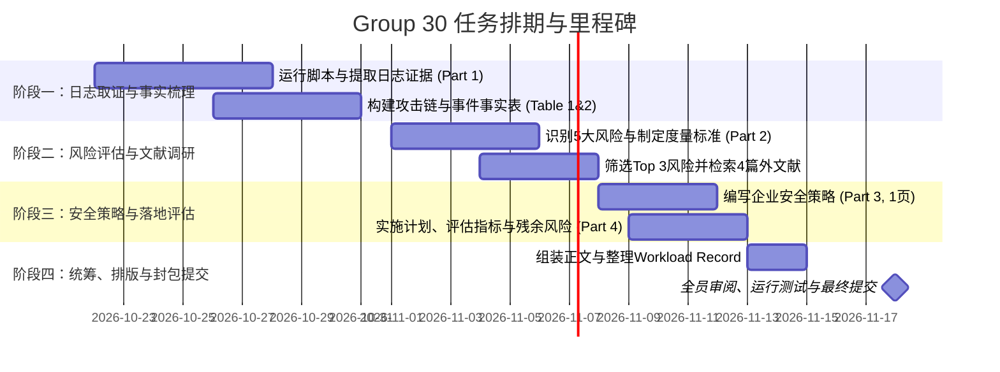

# 📅 Enterprise Cyber Security (ECS) - Group 30 Project Roadmap & Deadlines

> **项目名称**：Evidence-based Policy Group Assessment (From log evidence to security policy)  
> **小组编号**：Group 30 (`Solstice Continental` 案例)  
> **最终官方截止时间**：**2026年11月18日（周三）16:30 (UTC)**  
> **考核占比**：课程总成绩 20%  
> **报告限制**：正文严格不得超过 6 页（12pt 字体、1 英寸页边距），包含 1 页必填的 Workload Record

---

## 📌 一、 官方关键时间节点（Official Deadlines）

| 截止日期 | 时间 | 事项 | 责任人 / 提交方式 | 状态 |
| :--- | :--- | :--- | :--- | :--- |
| **2026-10-16** | 23:59 | Group AI Declaration（联合 AI 使用声明） | 全组协商后在 Moodle 勾选提交 | ✅ 已截止 |
| **2026-10-30** | 23:59 | **Group Wellbeing Survey（小组健康与合作问卷）** | 全体组员各自在 Moodle 完成 | ⏳ **进行中**（下周五前） |
| **2026-11-18** | **16:30** | **Final Assessment Submission（最终大作业 Zip 提交）** | 指定一名组员在 Moodle 代表全组提交 | 🚨 **终极截止日** |
| **2026-11-18** | 16:30 稍后 | Personal Assessment of Contribution (个人贡献私密互评) | 每位组员各自在 Moodle 单独提交（勿放入 Zip） | 🚨 **个人评分项** |

---

## 🚀 二、 小组内部冲刺排期表（Internal Milestone Timeline）

为了预留充裕的修改、查重与排版时间，建议全组在 **11月15日（提前3天）** 冻结终稿并完成打包。

### 详细时间规划表

| 阶段 / 周期 | 内部截止日期 | 核心产出目标 (Deliverables) | 涉及分工建议 | 评审/检查要点 |
| :--- | :--- | :--- | :--- | :--- |
| **第一阶段** 日志取证与攻击链梳理 *(占比 25%)* | **10月28日 (周三)** | 1. 运行 `analysis.py` 跑通 `group30` 的两个日志文件 2. 产出 `source_summary.csv` 与 `evidence_*.txt` 3. 确定攻击者 IP、失陷账号与事件时间线 | 组员 A & B（负责技术与代码跑数） | 确保数字 100% 来自 Group 30 自身日志，切勿抄袭其他组数据 |
| **第二阶段** 撰写 Part 1 & 构建风险矩阵 *(占比 30%)* | **11月04日 (周三)** | 1. 完成 **Part 1**（约1.5页，含 Table 1 事实表、Table 2 攻击链） 2. 识别至少 5 个具体风险点，构建可能性/影响度度量衡 3. 检索至少 4 篇外部权威文献（含至少 1 篇同行评审期刊） | 组员 C & D（负责风险量化与文献调研） | 矩阵排名前 3 的核心风险必须逻辑严密，并说明后两项未选中的理由 |
| **第三阶段** 安全策略与落地评估 *(占比 35%)* | **11月11日 (周三)** | 1. 完成 **Part 3 Policy**（严格控制在 1 页内，针对 Top 3 风险） 2. 完成 **Part 4 Implementation**（约1.5页，实施步骤、考核指标与残余风险） | 组员 E & F（负责策略规范与运营指标） | 策略条文必须符合 Solstice 零售商企业口吻，指标切实可度量 |
| **第四阶段** 整合统稿与 Workload Record *(占比 10%)* | **11月15日 (周日)** | 1. 全文合并至 6 页 PDF 模板（12pt 字体、1英寸边距） 2. 填写 1 页强制要求的 **Workload Record**（工作负荷记录表） 3. 附上 AI 使用合规声明与参考文献列表 | 全体组员线上/线下审阅 | ⚠️ 缺 Workload Record 或格式不符会直接扣 2 个 Grade Band |
| **最终封包** 打包、复现测试与提交 | **11月17日 (周二)** *(提前24小时)* | 1. 按学号命名 zip 包：`<学号1>_<学号2>_..._submission.zip` 2. 验证 zip 解压后在独立环境下能否正常跑通 `python3 analysis.py` 3. 选定一名组员代表在 Moodle 点击最终提交 | 提交人代表 + 全组交叉校验 | 确认 Moodle 显示上传成功，切勿拖到 11月18日 16:30 最后一刻 |

---

## 📋 三、 提交清单（Submission Checklist）

在最终打包 zip 文件前，请逐一核对以下检查项：

- [ ] **Zip 文件命名**：`学号1_学号2_..._submission.zip`
- [ ] **压缩包内文件**：
  - [ ] `report.pdf`（不超过 6 页，含封面、Part 1~4、参考文献、AI 使用声明，且必须包含 1 页 Workload Record）
  - [ ] `analysis.py`（文件顶部注释写明组号 Group 30 及相关参数）
  - [ ] `source_summary.csv`（脚本生成）
  - [ ] `evidence_*.txt`（脚本提取的证据文本）
- [ ] **独立性校验**：将 zip 包解压到新目录，运行 `python3 analysis.py` 能否无报错完整复现所有输出文件。
- [ ] **独立个人评分（PAC）**：每位组员各自登录 Moodle 提交各自的 `Personal Assessment of Contribution`（**严禁**放进 zip 包里！）。

---

## 👥 四、 评分标准权重分布（Marking Breakdown）

* **Part 1 - Analysis (分析与事实)**：**25%**
* **Part 2 - Risk Assessment (风险评估与矩阵)**：**30%**
* **Part 3 - Policy (安全策略制定)**：**20%**
* **Part 4 - Implementation & Evaluation (实施落地与指标)**：**15%**
* **Written Quality (学术与文字质量)**：**5%**
* **Team Performance (团队协作与工作记录)**：**5%**
